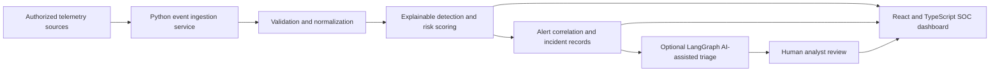

<div align="center">

# RedSentinel

### See the Threat. Understand the Risk. Defend with Intelligence.

**A defensive cloud threat-intelligence and security-operations dashboard** for exploring telemetry, explaining detections, correlating alerts, and guiding analyst-led incident triage.

[](https://www.typescriptlang.org/)
[](https://react.dev/)
[](https://www.python.org/)
[](https://vite.dev/)

</div>

---

## Overview

RedSentinel brings defensive security workflows into one analyst-friendly interface. It combines a TypeScript/React SOC dashboard with a Python service layout for event ingestion, detection, incident handling, and AI-assisted triage.

The project is designed to make alerts easier to understand—not to replace security analysts. Deterministic detection and event evidence provide the foundation; AI-generated summaries and recommendations are advisory and should be reviewed before action.

> **Project status:** The frontend includes sample data and attack-scenario simulations for demonstration. The animated background is a visual effect, not a live network sensor. Connect and validate authorized telemetry sources and backend services before treating the dashboard as a production monitoring system.

## What you can do

- **Monitor a SOC-style dashboard** with event, alert, and incident views.
- **Explore security events** with normalized fields such as event type, account, host, source address, severity, and timestamp.
- **Evaluate explainable detection rules** and inspect the reasons an event or sequence was flagged.
- **Correlate related alerts into incidents** and track severity, risk score, status, and review state.
- **Simulate defensive scenarios** such as repeated authentication failures followed by a success, privilege changes, event bursts, or off-hours activity. Simulations use generated records and are intended for safe testing and demos.
- **Review threat intelligence context** associated with alerts and events.
- **Use AI-assisted triage** to produce an evidence-grounded incident summary and investigation or containment suggestions, subject to analyst review.
- **Keep an analyst workflow** with incident status updates, notes, and audit-style activity entries.
- **Reduce motion** in the interface using the settings control.

## Detection rules and risk model

The Python platform documentation describes six explainable defensive detection patterns:

| Rule | Purpose |
|---|---|
| `RS-AUTH-001` | Detect repeated authentication failures. |
| `RS-AUTH-002` | Identify suspicious failure-then-success login sequences. |
| `RS-IAM-003` | Flag privilege changes and access-key creation. |
| `RS-TIME-004` | Surface sensitive activity outside expected hours. |
| `RS-VOL-005` | Identify unusual event or request bursts. |
| `RS-CORR-006` | Correlate signals across entities into a possible attack progression. |

The documented scoring model uses a transparent **0–100 risk score** and considers factors such as the detection baseline, corroborating evidence, event sequence, and asset criticality. Risk is intended to help prioritize investigation; it is not a verdict that an event is malicious. Review the underlying evidence and tune thresholds to your environment before operational use.

## AI-assisted analysis model

RedSentinel’s documented triage design uses **LangGraph to orchestrate an eight-stage workflow**, with Google Gemini/Google GenAI listed as the language-model integration:

1. Validate incident input.
2. Enrich the case with available event and entity context.
3. Extract observable evidence.
4. Assess advisory risk against the deterministic detection baseline.
5. Draft an analyst-readable summary.
6. Suggest defensive investigation and response steps.
7. Check the output against evidence and verification guardrails.
8. Present the result for human review.

This is **AI-assisted analysis, not a separately trained RedSentinel model**. Model availability depends on configuring the provider integration and a valid API credential. Treat generated content as untrusted until checked against logs and other authoritative sources. Do not send sensitive production data to an external model unless your organization has approved that data flow.

## Live monitoring, motion, and guided response

“Live” in the current interface refers to an interactive SOC-style experience: metrics and views respond to events added in the app, while the particle-network canvas provides ambient motion. The included scenario simulator can generate synthetic telemetry to demonstrate how detections, alerts, and incidents may flow through the UI.

A true live deployment additionally requires a configured event source, secure ingestion, persistent storage, backend-to-dashboard integration, monitoring, and operational controls. Do not interpret animation or synthetic sample records as evidence of live production telemetry.

Guided triage is advisory. Analysts should verify evidence, follow their organization’s incident-response procedures, and explicitly approve any consequential action. The project is intended for authorized defensive security work and controlled demonstrations.

## Architecture



The repository contains two main parts:

- **Frontend at the repository root:** React 19, TypeScript, Vite, Tailwind CSS, and Lucide icons. The app includes dashboard, events, threat-intelligence, incident-investigation, AI-analysis, detection-rules, settings, and simulation views.
- **Python platform under `RedSentinel/`:** Django/DRF core, a Flask ingestion service, detection and incident modules, tests, sample data, and LangGraph/Google GenAI dependencies, as documented in that project directory.

## Technology

| Area | Technologies |
|---|---|
| Web interface | React 19, TypeScript, Vite, Tailwind CSS v4 |
| UI motion and icons | Motion, Lucide React, custom particle canvas |
| Python services | Django, Django REST Framework, Flask, Pydantic |
| AI orchestration | LangGraph, LangChain Core, Google GenAI/Gemini integration |
| Data layer | Django ORM; SQLite/PostgreSQL are described in the platform documentation |
| Quality | TypeScript check, Python tests, and documented detection/ingestion test coverage |

## Get started

### Frontend

**Prerequisites:** Node.js and npm.

```bash
git clone https://github.com/saravanavel07/Red-Sentinel-ThreatIntelligence.git
cd Red-Sentinel-ThreatIntelligence
npm install
npm run dev
```

Open the local URL printed by Vite (the project’s dev script uses port `3000`).

Useful commands:

```bash
npm run lint   # TypeScript type check
npm run build  # Production frontend build
npm run preview
```

### Python platform

The Python project is in `RedSentinel/`. Use a virtual environment and install its requirements:

```bash
cd RedSentinel
python -m venv .venv
# macOS/Linux
source .venv/bin/activate
# Windows PowerShell: .venv\Scripts\Activate.ps1
pip install -r requirements.txt
```

Configure the environment variables required by the Django, ingestion, and AI integrations in your local environment. Keep secrets out of source control. Then, from `RedSentinel/`, the documented commands are:

```bash
python manage.py migrate
python manage.py runserver
```

In another terminal, start the ingestion service using the project’s documented entry point:

```bash
cd RedSentinel
python ingestion_service/app.py
```

The Python service and frontend are separate components; confirm their endpoints, credentials, CORS settings, and data flow are configured for your environment before expecting end-to-end live events.

### AI provider credentials

The frontend package includes the Google GenAI SDK, and the Python requirements include Google GenAI. If enabling Gemini-backed analysis, configure the API key according to the provider integration and run it through a trusted server-side service. **Never commit API keys or expose privileged credentials in browser code.** If the key has been exposed, revoke it and issue a replacement.

## Safe demonstration

Use the dashboard’s scenario simulation to explore the workflow with generated events. Keep simulation targets synthetic and within this application. For real telemetry, only connect systems you own or are explicitly authorized to monitor, protect credentials and personal data, and test rules in a non-production environment first.

## Repository map

```text
.
├── src/                      # React/TypeScript dashboard
│   ├── components/           # Navigation, canvas, and simulation UI
│   ├── services/             # Client-side detection and sample data
│   ├── types/                # Security event and incident types
│   └── views/                # Dashboard, events, incidents, triage, settings
├── RedSentinel/              # Python platform
│   ├── config/               # Django configuration
│   ├── detections/           # Detection logic
│   ├── ingestion_service/    # Flask event ingestion service
│   ├── incidents/            # Incident workflow
│   ├── triage/               # AI-assisted triage components
│   ├── sample_data/          # Demonstration data
│   └── tests/                # Python tests
├── package.json
└── README.md
```

## Testing and validation

Frontend type check and production build:

```bash
npm run lint
npm run build
```

Python test suite (from `RedSentinel/`):

```bash
python -m unittest discover tests
```

Before deployment, verify the tests match the current code, configure authentication and secrets securely, validate ingestion limits and schemas, and exercise detections against representative benign and test data.

## Security and operational notes

- This repository is a defensive security project; use it only for systems and data you are authorized to monitor.
- Sample events and simulated scenarios are for demonstration and testing, not indicators of an active incident.
- AI output can be incomplete or incorrect. Validate every claim against telemetry and require analyst review.
- Store secrets outside the repository; restrict access to ingestion endpoints and use transport security in deployed environments.
- Review privacy, retention, access-control, audit, and incident-response requirements before connecting production data.
- The current frontend contains in-memory application state; confirm persistence and backend integration rather than assuming data survives a reload.

## License

A license file is present under `RedSentinel/`. Review its terms before redistributing or reusing the project. If you intend to license the entire repository, consider adding a license at the repository root so the scope is unambiguous.

---

<div align="center">

**RedSentinel — See the Threat. Understand the Risk. Defend with Intelligence.**

</div>
