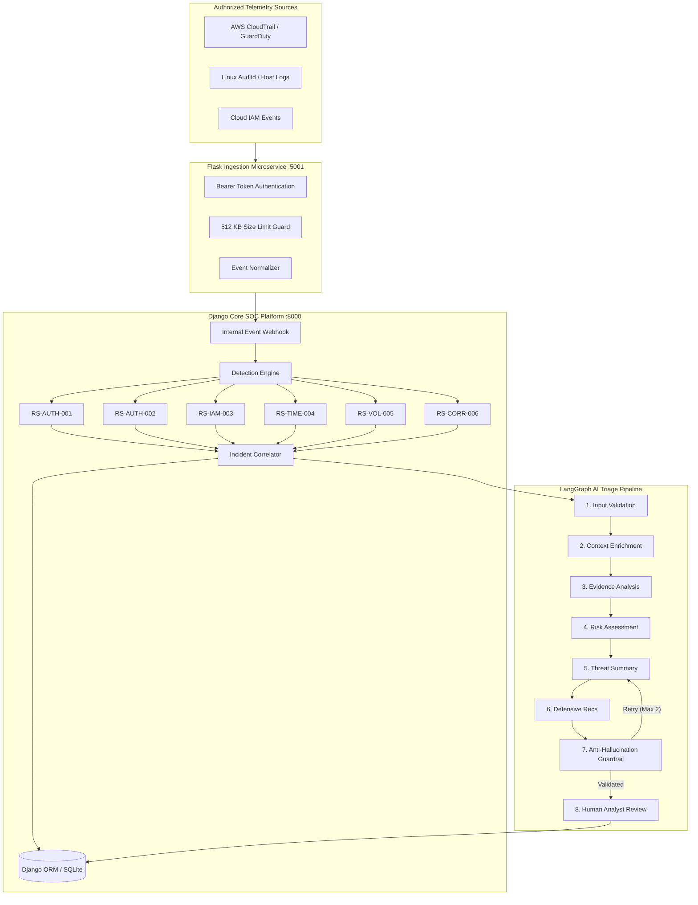

# RedSentinel — Cloud + AI Threat Detection & Intelligence Platform

> **Tagline:** *See the Threat. Understand the Risk. Defend with Intelligence.*

```
   ██████╗ ███████╗██████╗ ███████╗███████╗███╗   ██╗████████╗██╗███╗   ██╗███████╗██╗     
   ██╔══██╗██╔════╝██╔══██╗██╔════╝██╔════╝████╗  ██║╚══██╔══╝██║████╗  ██║██╔════╝██║     
   ██████╔╝█████╗  ██║  ██║███████╗█████╗  ██╔██╗ ██║   ██║   ██║██╔██╗ ██║█████╗  ██║     
   ██╔══██╗██╔══╝  ██║  ██║╚════██║██╔══╝  ██║╚██╗██║   ██║   ██║██║╚██╗██║██╔══╝  ██║     
   ██║  ██║███████╗██████╔╝███████║███████╗██║ ╚████║   ██║   ██║██║ ╚████║███████╗███████╗
   ╚═╝  ╚═╝╚══════╝╚═════╝ ╚══════╝╚══════╝╚═╝  ╚═══╝   ╚═╝   ╚═╝╚═╝  ╚═══╝╚══════╝╚══════╝
```

[](https://python.org)
[](https://djangoproject.com)
[](https://flask.palletsprojects.com)
[](https://langchain-ai.github.io/langgraph/)
[](LICENSE)
[](tests/)

---

## 1. Project Overview
**RedSentinel** is a production-inspired, defensive cybersecurity threat detection and intelligence platform. Built with a clean separation of concerns, it pairs deterministic rule evaluation with an 8-node LangGraph-orchestrated AI triage engine to help Security Operations Center (SOC) analysts detect, correlate, and investigate security incidents across cloud and host environments.

---

## 2. Problem Statement
Modern SOC analysts face alert fatigue:
- Thousands of disparate telemetry events flood SOC pipelines every hour.
- Black-box AI detectors generate hallucinatory, ungrounded threat alerts without clear evidence chains.
- Monolithic SIEMs tightly couple ingestion with analysis, making it brittle to scale log collection independently.

---

## 3. The RedSentinel Solution
RedSentinel addresses these challenges with a three-pillar architecture:
1. **Independent Ingestion**: A lightweight, token-secured Flask microservice validates and normalizes events at the network perimeter.
2. **Deterministic Detection & Correlation Engine**: 6 explainable rules grounded in MITRE ATT&CK techniques calculate transparent risk scores (0–100) separating **Risk**, **Severity**, and **Confidence**.
3. **LangGraph-Orchestrated AI Triage**: An 8-node state workflow enriches context, synthesizes evidence, generates defensive investigation steps, enforces anti-hallucination verification guardrails, and requires human analyst review before action.

---

## 4. Key Features
- **Deterministic Detection Rules**:
  - `RS-AUTH-001`: Repeated Authentication Failures (brute force threshold)
  - `RS-AUTH-002`: Suspicious Login Sequence (failures immediately followed by success)
  - `RS-IAM-003`: Privilege Change Monitoring (unexpected admin escalation & key creation)
  - `RS-TIME-004`: Unusual Activity Time (sensitive off-hours operations)
  - `RS-VOL-005`: Event Burst Detection (abnormal request surge)
  - `RS-CORR-006`: Suspicious Multi-Signal Correlation (cross-entity attack progression)
- **Transparent Risk Scoring (0–100)**: Explains the exact mathematical factors (base score, corroborating evidence count, attack sequence, and asset criticality).
- **LangGraph 8-Node State Machine**: Structured triage pipeline with bounded retries and strict evidence-grounding guardrails.
- **Cybersecurity Dark UI**: High-contrast `#090B10` theme with live particle network, SVG hacker emblem, real-time SOC metrics, log explorer, and attack simulator.

---

## 5. Architecture Diagram



---

## 6. Technology Stack
| Layer | Technologies | Purpose |
|---|---|---|
| **Primary Web Core** | Python 3.10+, Django 4.2+, Django REST Framework | User management, ORM models, audit logging, admin portal |
| **Ingestion Microservice** | Flask 3.0+, Flask-CORS, Pydantic | High-throughput event ingestion, token authorization, payload validation |
| **AI Orchestration** | LangGraph, Gemini API / Google GenAI SDK | 8-node state machine triage, evidence synthesis, verification guardrails |
| **Database** | Django ORM, SQLite / PostgreSQL | Event telemetry, detection rules, security alerts, auditable incident store |
| **Interactive Frontend** | React 19, TypeScript, Vite, Tailwind CSS v4 | High-density SOC dashboard, live particle canvas, incident room, MITRE intelligence |

---

## 7. LangGraph Threat Analysis Workflow

The AI analysis pipeline follows 8 explicit nodes:

1. **Node 1 — Input Validation**: Inspects incoming incident dictionaries, rejecting malformed structures.
2. **Node 2 — Event Context**: Queries the database for related event timestamps, source IPs, affected account/host identity, and rule definitions.
3. **Node 3 — Evidence Analysis**: Analyzes observable telemetry signals and extracts concrete indicators without inventing unobserved facts.
4. **Node 4 — Risk Assessment**: Formulates an advisory risk score anchored to the deterministic detection engine baseline.
5. **Node 5 — Threat Summary**: Generates concise analyst-readable answers to *What happened?* and *Why was it flagged?*.
6. **Node 6 — Defensive Recommendations**: Constructs actionable, step-by-step investigation and containment directives.
7. **Node 7 — Verification & Anti-Hallucination**: Runs the output through `VerificationGuardrail` to eliminate sensational or unsubstantiated claims.
8. **Node 8 — Human Review Checkpoint**: Presents the final report to the SOC analyst for sign-off, adjustment, or escalation.

---

## 8. Installation & Setup Instructions

```bash
# Clone the repository
git clone https://github.com/your-org/redsentinel-cloud-ai-threat-detection.git
cd redsentinel-cloud-ai-threat-detection/RedSentinel

# Create a virtual environment
python3 -m venv .venv
source .venv/bin/activate  # Windows: .venv\Scripts\activate

# Install dependencies
pip install -r requirements.txt

# Configure environment variables
cp .env.example .env
```

---

## 9. Running the Platform Services

### Step 1: Run Django Core Application
```bash
python manage.py migrate
python manage.py runserver 0.0.0.0:8000
```

### Step 2: Run Flask Ingestion Microservice
```bash
python ingestion_service/app.py
# Listens on http://0.0.0.0:5001
```

### Step 3: Run Interactive SOC Web Dashboard
```bash
npm install
npm run dev
# Interactive dashboard on http://localhost:3000
```

---

## 10. Automated Test Suite

RedSentinel includes a comprehensive unit test suite covering normalization, rules, risk scoring, state machines, and ingestion security:

```bash
python3 -m unittest discover tests
```

**Test Execution Output:**
```text
..................
----------------------------------------------------------------------
Ran 18 tests in 0.003s

OK
```

---

## 11. Security & Privacy Safeguards
- **Synthetic Grounding**: Default demonstration logs are synthetic.
- **Zero Raw Password Storage**: Ingestion pipelines scrub credentials.
- **Anti-Prompt-Injection**: Log fields are placed in structured metadata, never direct agent instructions.
- **Human Analyst in the Loop**: Containment directives require explicit analyst confirmation.
- **Immutable Audit Logging**: Every incident status update, analyst note, and triage action writes to `AuditLog`.

---

## 12. Known Limitations & Roadmap
- Current implementation uses synthetic AWS CloudTrail / Auth event schemas.
- Planned future connectors: Azure Activity Logs, Google Cloud Audit Logs, and Syslog RFC 5424.
- Planned enhancement: Automated bidirectional integration with Splunk and Jira Service Desk.

---

## 13. License
Licensed under the Apache License, Version 2.0. See [LICENSE](LICENSE) for details.
