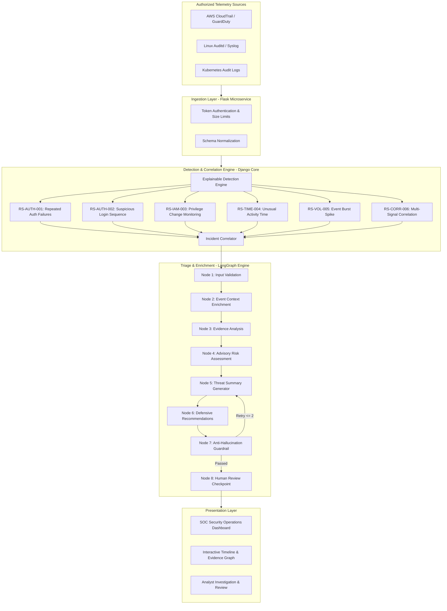

# RedSentinel Platform Architecture

## System Overview

RedSentinel operates as a multi-tier threat detection and intelligence platform designed for hybrid cloud and enterprise environments. The platform processes raw security telemetry into actionable incident intelligence through deterministic rules and LangGraph-orchestrated AI triage.

## Service Communication
- **Flask Ingestion Microservice (`port 5001`)**: Authenticates log shippers via API tokens (`Authorization: Bearer <TOKEN>`), enforces a 512KB payload ceiling, validates schema, and dispatches to Django Core via internal webhook.
- **Django Core Platform (`port 8000`)**: Evaluates events across 6 deterministic rules, correlates alerts into incidents, records audit logs, and handles analyst actions.
- **LangGraph AI Orchestration**: Orchestrates an 8-node state workflow using TypedDict state schema, validating claims against ground telemetry to eliminate hallucinations.
